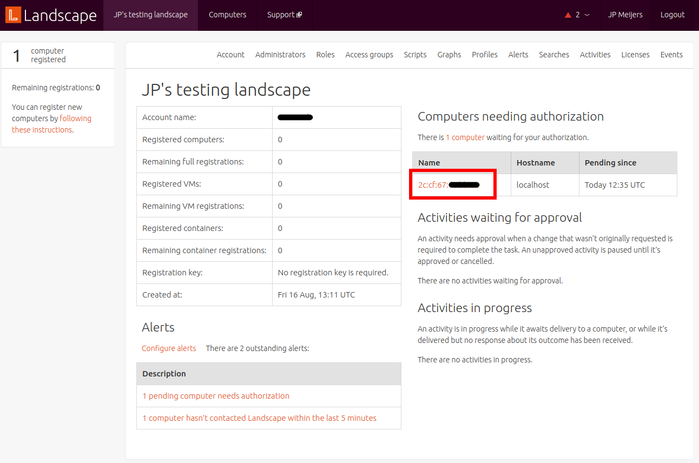
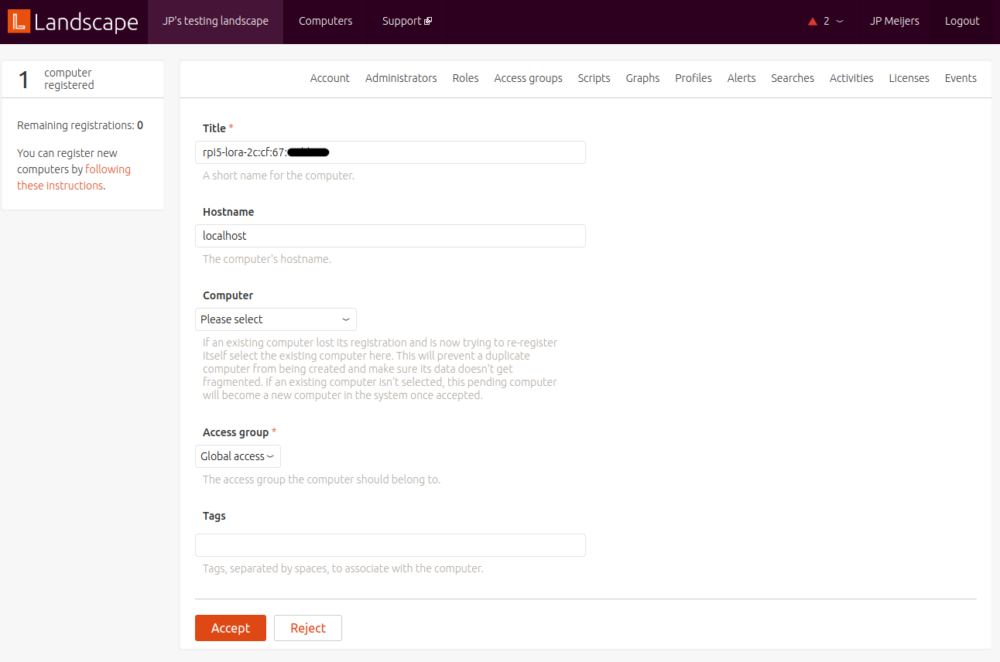
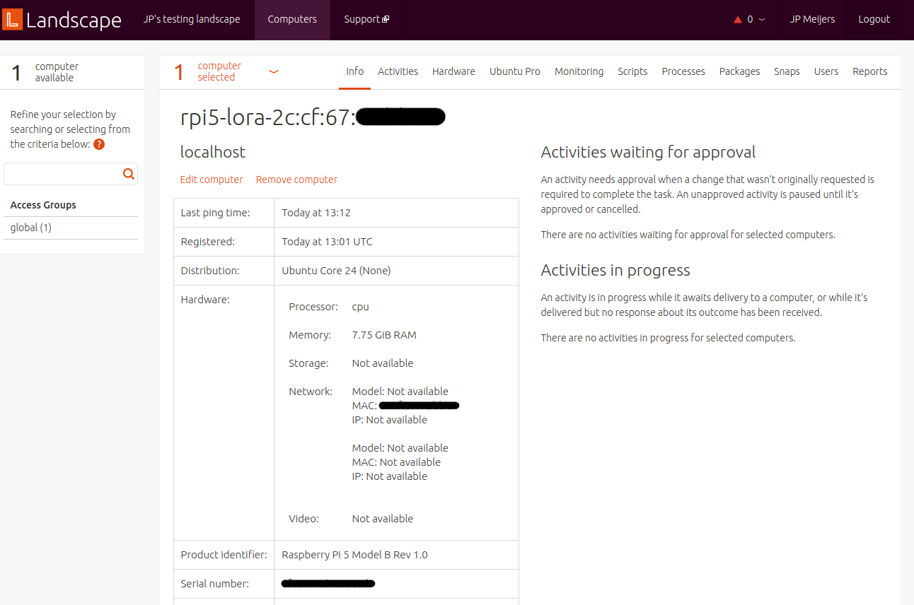
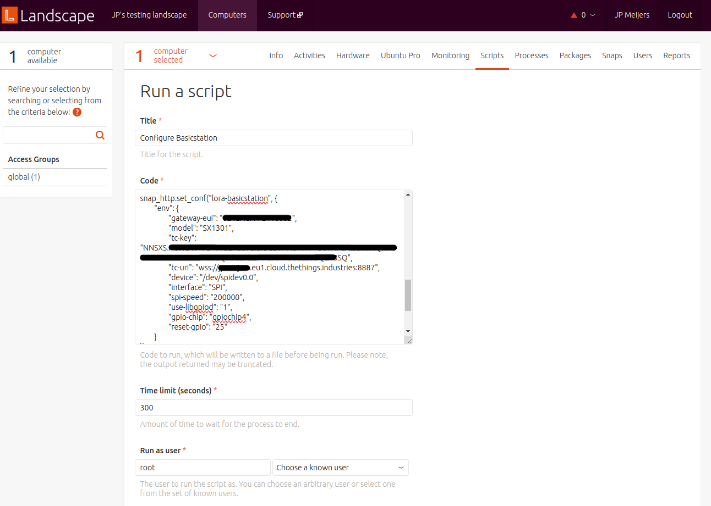
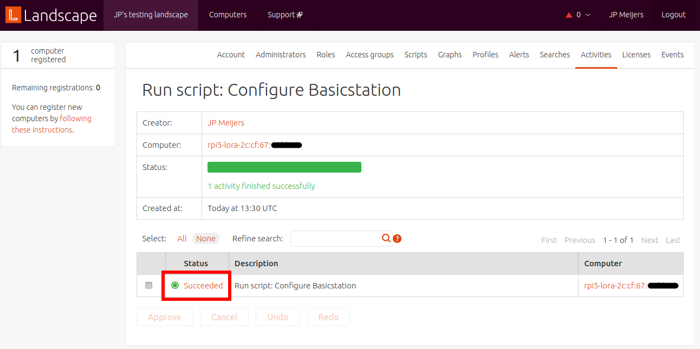
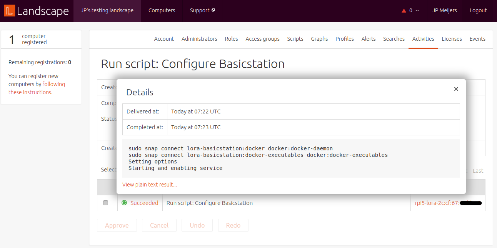
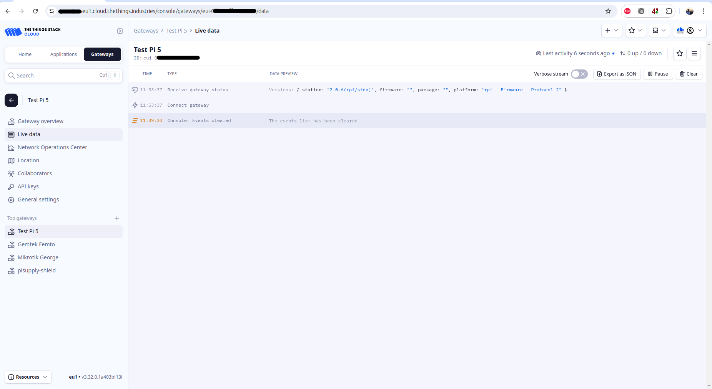

# Manage a fleet of LoRa  gateways using Ubuntu Core with Landscape
[Landscape](https://ubuntu.com/landscape) is a Canonical service for fleet management of devices running Ubuntu. 

It's possible to manually install LoRa Basics Station one by one on multiple Ubuntu Core devices. 
This, however, is not scalable. 
A single disk image that can be flashed to multiple devices and personalized after the first boot would make deployment of large fleets easier.
Ubuntu Core enables the creation of images, with a custom set of software packages, that can then be deployed to multiple machines, and personalized and managed using Landscape.

This guide shows you how to build an Ubuntu Core image containing a LoRa gateway, flash it onto a device(s), and configure it using Landscape. 
These instructions are written for, and tested with, a Raspberry Pi 5. 
However, with some modification, they should also work on other platforms.

```{note}
Before you continue, you should know how to [build an Ubuntu Core image](https://ubuntu.com/core/docs/build-an-image).
You'll also need a Landscape account on a Landscape server.
You can use the [Landscape SAAS](https://landscape.canonical.com/) included with your Ubuntu Pro account.
```
## Create working directory
Create a working directory for the configuration of the image.
This is where you will create the definition of the image and where the resulting image will be built and stored.

```bash
mkdir lora-ubuntu-core-image
cd lora-ubuntu-core-image
```

## Build the gadget snap

The [gadget snap](https://snapcraft.io/docs/the-gadget-snap) defines and configures system properties that are specific to one or more devices.
A custom version of this snap must be included as part of the Ubuntu Core image to set up the bootloader and other components.
In this case, it is used to load default configurations onto the image such as Landscape and WiFi credentials.

To create the custom gadget snap, start by cloning the [Raspberry Pi gadget snap](https://github.com/canonical/pi-gadget/tree/24) repository into the working directory.

```bash
git clone https://github.com/canonical/pi-gadget --branch 24
```

The repository will be cloned into a new `pi-gadget` subdirectory.
Inside this subdirectory, edit the `gadget.yaml` file by appending this code:

```yaml

defaults:
  # Add default configurations for landscape-client snap using the snap-id
  ffnH0sJpX3NFAclH777M8BdXIWpo93af:
    landscape-url: https://landscape.canonical.com
    account-name: "REPLACE-ME"
    registration-key: ""
    auto-register:
      enabled: true
      computer-title-pattern: ${mac}
      wait-for-serial-as: false

  system:
    # Disable console-conf so that we do not have an interactive installer at first bootup
    service:
      console-conf:
        disable: true

    # Add this if you want to preconfigure wifi credentials
    system:
      network:
        netplan:
          network:
            version: 2
            wifis:
              wlan0:
                dhcp4: true
                access-points:
                  "my-wifi-ssid":
                    password: "my-wifi-password"
```

You will also need to update the Landscape account name and the Landscape server URL to match your account and server.
If you also want to preconfigure WiFi, update the WiFi SSID and password.

Finally, build the gadget snap by running:

```shell
cd pi-gadget
snapcraft -v
cd ..
```

## Set up the model

Create a new model assertion by creating an empty file called `model.json` in the working directory and inserting the code below.

```json
{
    "type": "model",
    "series": "16",
    "model": "uc24-pi-arm64-lora",
    "architecture": "arm64",
    "authority-id": "REPLACE-ME",
    "brand-id": "REPLACE-ME",
    "timestamp": "2024-08-20T12:20:00+00:00",
    "base": "core24",
    "grade": "dangerous",
    "snaps": [
        {
            "name": "pi",
            "type": "gadget"
        },
        {
            "name": "pi-kernel",
            "type": "kernel",
            "default-channel": "24/stable",
            "id": "jeIuP6tfFrvAdic8DMWqHmoaoukAPNbJ"
        },
        {
            "name": "core24",
            "type": "base",
            "default-channel": "latest/stable",
            "id": "dwTAh7MZZ01zyriOZErqd1JynQLiOGvM"
        },
        {
            "name": "core22",
            "type": "base",
            "default-channel": "latest/stable",
            "id": "amcUKQILKXHHTlmSa7NMdnXSx02dNeeT"
        },
        {
            "name": "snapd",
            "type": "snapd",
            "default-channel": "latest/stable",
            "id": "PMrrV4ml8uWuEUDBT8dSGnKUYbevVhc4"
        },
        {
            "name": "docker",
            "type": "app",
            "default-channel": "latest/stable",
            "id": "sLCsFAO8PKM5Z0fAKNszUOX0YASjQfeZ"
        },
        {
            "name": "lora-basicstation",
            "type": "app",
            "default-channel": "latest/edge",
            "id": "Ym43FmNEiZgqaAciYg6EMqRC4dUjcYYb"
        },
        {
            "name": "landscape-client",
            "type": "app",
            "default-channel": "latest/beta",
            "id": "ffnH0sJpX3NFAclH777M8BdXIWpo93af"
        }
    ]
}

```

This model assertion includes the `landscape-client`, `lora-basicstation`, and `docker` snaps.
```{note}
If you followed the prerequisite guide on [how to build an Ubuntu Core image](https://ubuntu.com/core/docs/build-an-image), you should already have generated and registered a snap signing key.
The same key should be used here.
```
Update the `authority-id` and `brand-id` fields with your [developer id](https://ubuntu.com/core/docs/create-ubuntu-one).
Next, update the `timestamp` field to the current time, making sure it falls within the validity period of your snap signing key.
Finally, execute this command to sign the model:

```
snap sign -k my-model-key model.json > model.model
```

## Build the image

Install the `ubuntu-image` application:

```bash
sudo snap install ubuntu-image --classic
```

Then, build a disk image from the signed model:

```shell
ubuntu-image snap --snap pi-gadget/pi_24-1_arm64.snap --validation=enforce model.model
```
The path to the custom gadget snap built earlier is set because it must be side-loaded into the image during the build process.

This should return:

```
[0] prepare_image
WARNING: the kernel for the specified UC20+ model does not carry assertion max formats information, assuming possibly incorrectly the kernel revision can use the same formats as snapd
WARNING: "pi" installed from local snaps disconnected from a store cannot be refreshed subsequently!
[1] load_gadget_yaml
[2] set_artifact_names
[3] populate_rootfs_contents
[4] generate_disk_info
[5] calculate_rootfs_size
[6] populate_bootfs_contents
[7] populate_prepare_partitions
[8] make_disk
[9] generate_snap_manifest
Build successful
```

If the build was successful you will find a file called `pi.img` in the working directory.

```{note}
During the build process you will see two warnings.

- The warning about the kernel is explained in this [forum discussion](https://forum.snapcraft.io/t/ubuntu-image-warning-kernel-snap/37774/3).
- The warning about the `pi` snap is caused by the side-loading of a custom locally built snap. The snap is not provided via the Snap Store and will, therefore, not get updates. To update custom gadget snaps like these, you will need a [dedicated Snap Store](https://ubuntu.com/core/docs/dedicated-snap-stores).
```
## Flash the image to a device

Flash the `pi.img` file to an SD card using Raspberry Pi Imager.
After flashing, insert the SD card into a Raspberry Pi and power it on.
If you have a monitor connected, you will see a login prompt after a couple of minutes.
It is not possible to log in here as there is no user configured.

## Locate the device on Landscape dashboard
Your Raspberry Pi should automatically register with Landscape after starting up.
In the gadget snap, `landscape-client` is configured to use the device mac address as name.
Therefore, your Raspberry Pi will appear on your Landscape dashboard as a pending device with its mac address as the name.




Click on this name to configure the device.
You can also customize the device title here.
Click accept to add the device to your Landscape instance.



After accepting you will see the info page for the device.

You'll need to wait several minutes for the device to check in. 
Once this is done, the info page will show some basic parameters of the device such as total memory, model, and MAC addresses.



Devices are called computers on Landscape.
To get back to this page in the future, go to the computers menu and select the device you are interested in from the list.

## Verify installed snaps

To see which snaps are installed on a device, click on the Snaps tab and then click on **Installed snaps**.
You will see the list of installed snaps. 
You can update or remove a Snap from here.
Verify that `lora-basicstation` is in the list.

To install more software on your device, click on **Install snaps** under the Snaps tab.

## Configure the gateway

Configuration of an Ubuntu Core device with Landscape is done using scripts.
To configure your gateway, you'll need to set snap options for `lora-basicstation` via a script.
Download this [example script](manage-fleet-uc-gateways-landscape/configure-lora-basicstation.sh) to continue.

On Landscape, after selecting your device from the list of computers, go to the scripts tab.
If presented with a choice, select **Run a new script** and click **Next**.
You will see a form to create a new script.
Give it a name, e.g., *Configure Basicstation*.

In the code block paste the contents of the example script above.
You can modify the configuration in the script to suite your needs.
This configuration roughly follows the process discussed in the {ref}`configuration step <gateway-configuration>` of setting up a LoRa Basics station on Ubuntu Core.

For *run as user* use `root`.
Save the script and click **Run**.



You will be redirected to the Activities tab where you will see the progress of the script.
After a couple of minutes you should see a success.



The text in the status column (`Succeeded` in this case) is clickable. Clicking on it will open a window to show the output of the script. If the script succeeded, the output will include `stdout`. If it failed, it will show `stderr`.



Log into your LoRa network server and confirm that the gateway is connected.



## Debug

Debugging can be done by running scripts on the device.
Checkout this page for [example scripts for Ubuntu Core devices on Landscape](https://github.com/canonical/landscape-scripts/tree/main/core).

Another debugging option is creating a user account on the device and logging into it over SSH or locally with a keyboard and mouse.
The user management interface of Landscape does not currently work for Ubuntu Core.
Follow this link to see [example scripts to add users](https://github.com/canonical/landscape-scripts/tree/main/core/users).

For instance, the `add-sso-user.py` script will add a user with an SSH key obtained from a Launchpad account.


