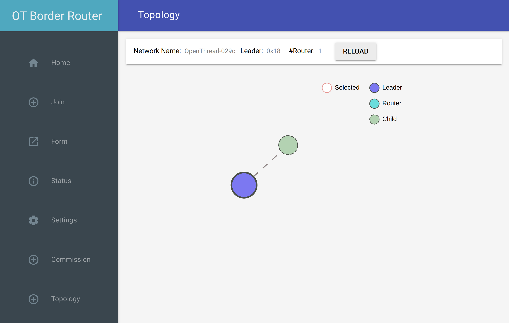

# How to commission and control Matter devices with Chip Tool

Chip Tool is an open source Matter Controller with a command-line
interface (CLI). It is useful for development and testing of Matter
devices from a Linux machine.

Chip Tool offers a wide range of capabilities, ranging from device
commissioning and control to setup and operational payload generation
and parsing.

This document guides you through setting up and configuring Chip Tool
using a Snap. This makes it extremely easy to securely run and use the
tool on Linux.

## Install

First and foremost, make sure to have SnapD installed. It is
pre-installed on some distributions such as Ubuntu. Refer to
[Installing SnapD] for details.

Install the dependencies:

`````{tabs}
````{group-tab} Ubuntu Server / Desktop

```bash
sudo apt update
sudo apt install bluez avahi-daemon
```
````
````{group-tab} Ubuntu Core

```bash
sudo snap install bluez avahi
```
````
`````
Install the Chip Tool snap:

```shell
sudo snap install chip-tool
```

```{tip}
Pre-release versions of Chip Tool are available in different [channels]
```

Once installed, the application should be available as ``chip-tool`` on your machine.

The snap restricts the app's access to only the necessary resources on the host.
This access is managed via [snap interface] connections.

By default, the snap auto connects the following interfaces:

- [network] to access the host network
- [network-bind] to listen on a port (Chip Tool's interactive mode)
- [avahi-observe] to discover devices over DNS-SD
- [bluez] to communicate with devices over Bluetooth Low Energy (BLE)

To verify the interface connections, run: `snap connections chip-tool`

## Commission

```````{tabs}
``````{group-tab} WiFi/Ethernet
Discover using DNS-SD and pair:

```shell
chip-tool pairing onnetwork 110 20202021
```
where:
- `110` is the node id being assigned to the device
- `20202021` is the pin code set on the device

``````

``````{group-tab} Thread

To commission a Thread device advertising itself over BLE,
you need an active Thread network (formed by a Thread Border Router) and a Bluetooth interface. Chip Tool discovers the Thread Border Router via DNS-SD and communicates with it over WiFi/Ethernet network.

Here, we assume the use of OpenThread implementation of the Thread Border Router.

```{note}
You may need to [enable experimental Bluetooth support] to allow BLE advertising and discovery.
```

1. Obtain the Active Operational Dataset for the existing Thread network:
`````{tabs}
````{group-tab} Snap
```shell
sudo openthread-border-router.ot-ctl dataset active -x
```
````

````{group-tab} Docker
```shell
sudo docker exec -it otbr sh -c "sudo ot-ctl dataset active -x"
```
````

````{group-tab} Native
```shell
sudo ot-ctl dataset active -x
```
````
`````
The [dataset] is encoded in hex and contains several values including the network's security key. 

[//]: <> (TODO: Link to Explanation)

2. Discover over Bluetooth Low Energy (BLE) and pair:
```shell
chip-tool pairing ble-thread 110 hex:0e08...f7f8 20202021 3840
```
where:
- `110` is the node id being assigned to the device
- `0e08...f7f8` is the Thread network credential operational dataset, truncated for readability.
- `20202021` is the pin code set on the device
- `3840` is the discriminator id

````{note}
It is also possible to commission a Thread device using a manual pairing code, without using Bluetooth Low Energy (BLE).

```shell
chip-tool pairing code-thread 110 hex:0e08...f7f8 34970112332
```
where:

- `34970112332` is the short manual pairing code

Details on how to use this can be found in the [Matter documentation] 
````
3. (optional) On the OTBR GUI, under the Topology tab, you can now see the two connected Thread nodes:



``````
```````
## Control
Toggle:

```shell
chip-tool onoff toggle 110 1
```
where:
- `onoff` is the matter cluster name
- `on`/`off`/`toggle` is the command name
- `110` is the node id of the app assigned during the commissioning
- `1` is the endpoint of the configured device

## More reading

This documentation covered only some of the common scenarios for commissioning and controlling Matter devices via Chip Tool. The project provides a [guide] with various usage examples.

However, for a complete list of sub-commands and options, it is best to use the tool's usage instructions using the terminal.


<!-- Links -->
[installing SnapD]: https://snapcraft.io/docs/installing-snapd
[channels]: https://snapcraft.io/docs/channels
[snap interface]: https://snapcraft.io/docs/interface-management
[network]: https://snapcraft.io/docs/network-interface  
[network-bind]: https://snapcraft.io/docs/network-bind-interface 
[avahi-observe]: https://snapcraft.io/docs/avahi-observe-interface 
[bluez]: https://snapcraft.io/docs/bluez-interface
[enable experimental Bluetooth support]: https://project-chip.github.io/connectedhomeip-doc/guides/BUILDING.html#enable-experimental-bluetooth-support-and-disable-battery-plugin-in-bluez
[dataset]: https://openthread.io/reference/cli/concepts/dataset
[Matter documentation]: https://project-chip.github.io/connectedhomeip-doc/guides/chip_tool_guide.html#pairing
[guide]: https://project-chip.github.io/connectedhomeip-doc/guides/chip_tool_guide.html#using-chip-tool-for-matter-device-testing